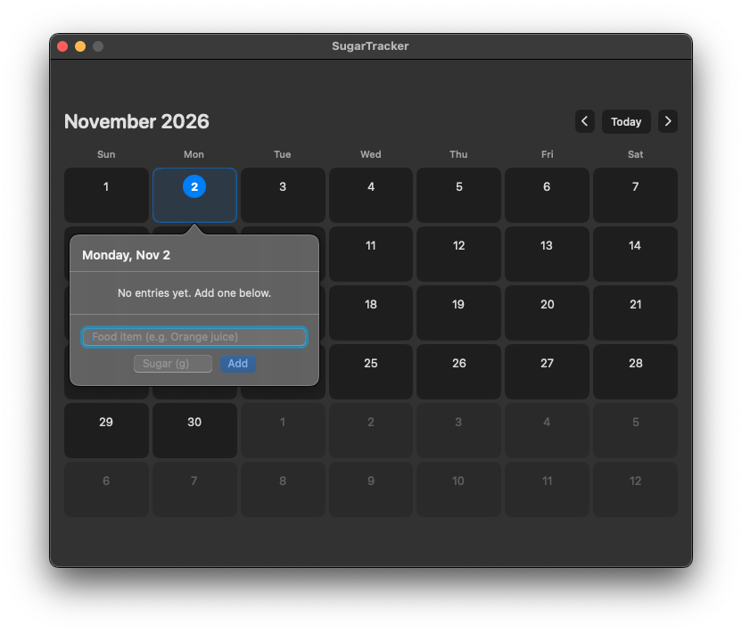
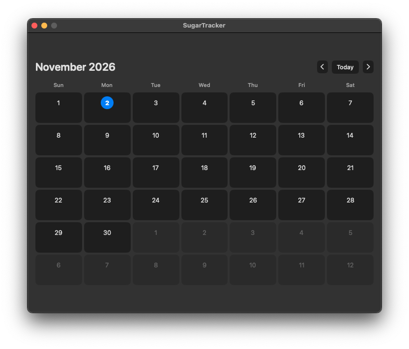

# SugarTracker — macOS App

A lightweight macOS app to track daily sugar intake with a calendar view.

---

## Requirements
- macOS 13 Ventura or Sonoma
- Xcode 15 or later

---

## Setup in Xcode (step by step)

### 1. Create a new project
- Open Xcode → **File → New → Project**
- Choose: **macOS → App** → click Next
- Fill in:
  - Product Name: `SugarTracker`
  - Interface: **SwiftUI**
  - Storage: **SwiftData**
  - Language: **Swift**
- Click Next → choose a save location → Create

### 2. Replace the generated files
Xcode will create `SugarTrackerApp.swift` and `ContentView.swift` for you.

- **Delete** the generated `Item.swift` (the default SwiftData model Xcode adds)
  - Right-click `Item.swift` in the Project Navigator → Delete → Move to Trash

- **Replace** `SugarTrackerApp.swift` with the provided file
- **Replace** `ContentView.swift` with the provided file
- **Add** `SugarEntry.swift` — drag it into the project or use File → New → File → Swift File

### 3. Build & Run
- Select **My Mac** as the run destination
- Press **Cmd+R** to build and run

---

## How to use

- **Navigate months** using the ← → arrows or the "Today" button
- **Click any day** to open a popover
- **Add a food item**: type the name + sugar grams → click Add (or press Return)
- **Delete an entry**: click the red minus button next to it
- **Color coding**:
  - 🟢 Green = under 25g (good)
  - 🟠 Orange = 25–50g (watch out)
  - 🔴 Red = over 50g (too much!)

Data is saved automatically via SwiftData — it persists between app launches.

---

## Files
| File | Purpose |
|------|---------|
| `SugarTrackerApp.swift` | App entry point, SwiftData container setup |
| `SugarEntry.swift` | Data model (@Model) |
| `ContentView.swift` | Calendar UI + popover entry form |

